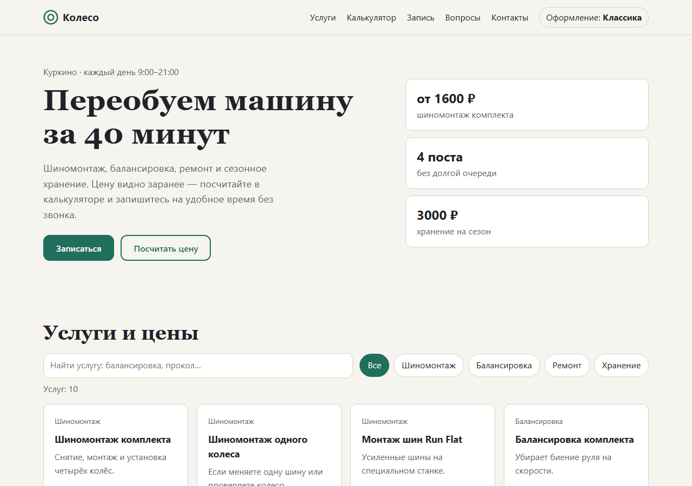
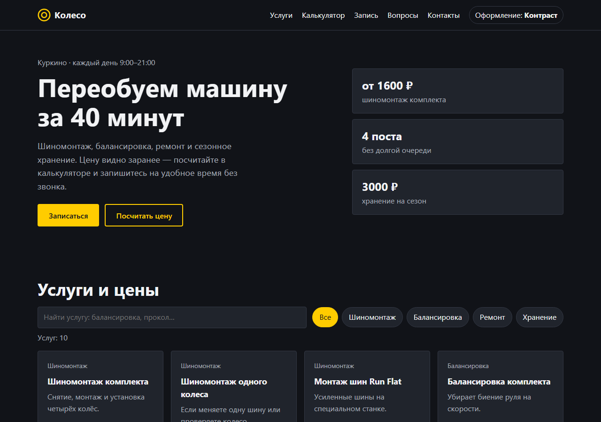
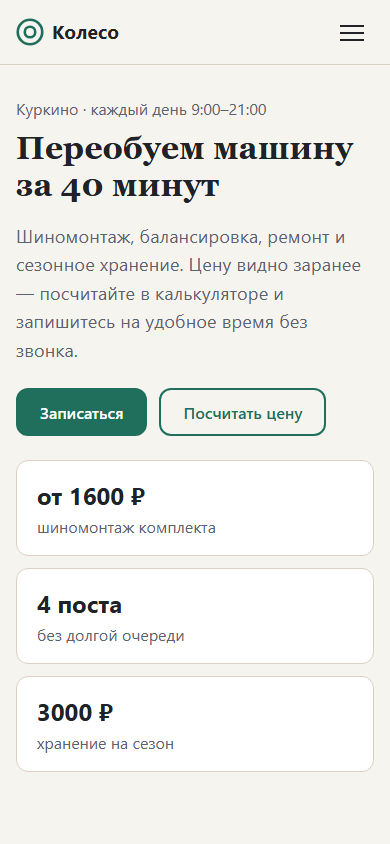

# tire-service-site — сайт шиномонтажа по брифу клиента

Одностраничный сайт для шиномонтажа: каталог услуг с поиском и фильтрами, калькулятор цены, онлайн-запись с проверкой полей, два варианта оформления и адаптивная вёрстка. Сделан по [брифу](brief.md) в том виде, в каком его присылает заказчик, на чистых HTML, CSS и JavaScript — без фреймворков и сборки. Публикуется на GitHub Pages только после того, как прошли проверки в браузере.

**Сайт:** https://timpobedim.github.io/tire-service-site/

| «Классика» | «Контраст» | Телефон |
|---|---|---|
|  |  |  |

## Что сделано по брифу

| Пункт брифа | Как сделано |
|---|---|
| Понять цену за минуту | калькулятор пересчитывает итог при каждом изменении: радиус, тип машины, услуги; цены и коэффициенты — из таблицы брифа |
| Много услуг — неудобно листать | поиск по названию и описанию, фильтр-«чипы» по разделам; ничего не нашлось — подсказка, а не пустой экран |
| Запись без звонка | форма с ошибками у каждого поля; нельзя записаться на прошедшую дату, на прошедший час сегодня и вне 9:00–21:00; телефон приводится к виду `7XXXXXXXXXX` |
| Половина заходов с телефона | сетка перестраивается на 860 и 760 px, меню прячется в кнопку, нет горизонтальной прокрутки на 360–1280 px |
| Два варианта оформления | «Классика» и «Контраст» — одни CSS-переменные с разными значениями; выбор запоминается |
| Быстро на мобильном интернете | ни одной библиотеки: страница — 3 файла, ~27 КБ без сжатия |
| Опубликовать и прислать ссылку | GitHub Actions: проверки → публикация на GitHub Pages |

Доступность: ссылка «К содержанию», подписи у всех полей, `aria-expanded` у меню, `aria-invalid` у полей с ошибкой, сообщения калькулятора и записи объявляются экранным дикторам (`aria-live`), фокус виден в обеих темах.

## Проверки

23 теста в настоящем браузере (pytest + Playwright): сайт отдаётся локальным сервером, как на хостинге, а любая ошибка JavaScript в консоли валит тест.

```bash
uv sync --group dev
uv run playwright install chromium
uv run pytest
```

| Что проверяется | Тесты |
|---|---|
| каталог: все услуги, поиск по названию и описанию, фильтр, пустой результат | 4 |
| калькулятор: значение по умолчанию, три расчёта по таблице брифа, ни одной услуги | 5 |
| запись: ошибки у всех полей, короткий телефон, прошедшая дата, прошедший час и нерабочее время, успешная заявка | 5 |
| адаптивность: нет горизонтальной прокрутки на 360/768/1280, мобильное меню открывается и закрывается, на компьютере меню видно всегда | 5 |
| доступность: у каждого поля есть подпись | 1 |
| оформление: переключение темы переживает перезагрузку; текст основной кнопки читается в обеих темах | 3 |

Последний тест появился после дефекта: в «Контрасте» правило для ссылок перекрасило кнопку-ссылку «Записаться» в цвет её же фона. Скриншот это показал, тест теперь не даст вернуть.

## Как устроено

```text
index.html     разметка: шапка, первый экран, каталог, калькулятор, запись, вопросы, контакты
css/style.css  две темы на CSS-переменных, сетки и точки перестройки
js/app.js      данные услуг и цен, каталог, калькулятор, проверка записи, темы, меню
tests/         проверки в браузере
brief.md       бриф клиента
```

Расчёт и проверка формы — отдельные функции без обращения к странице (`quote`, `validateBooking`), их можно вызвать из консоли: `Koleso.quote({radius: 17, car: "suv", mount: true, balance: true})`.

Заявки сохраняются в `localStorage` браузера: у учебного сайта нет сервера. Для настоящего клиента форма отправляла бы заявку в CRM или мессенджер администратора — это одна функция в `initBooking`.
